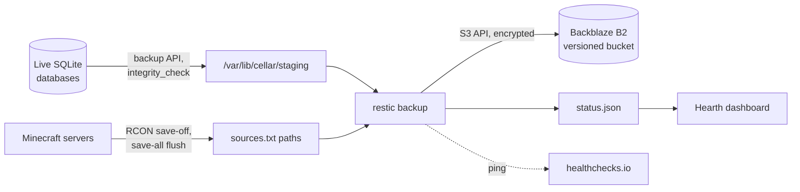

<h1 align="center">cellar</h1>

<p align="center">Encrypted off-box backups for a home server, with restic and Backblaze B2.</p>

<p align="center">
  
  
  
</p>

cellar backs a single Linux server up to Backblaze B2 without any other machine involved. restic takes encrypted,
deduplicated snapshots and sends them through B2's S3-compatible API. Live SQLite databases are copied consistently,
Minecraft servers pause auto-save for the duration, every week the repository is checked, and every month a restore
drill proves the backups can actually be read.

The repo is generic. Machine-specific settings (paths, bucket, keys, the repository password) live in `/etc/cellar/`
on the server and never enter the repo; each config file has an example in `etc/`.



## Components

- `bin/cellar`, a single Python script (standard library only) that wraps restic. Subcommands: `backup`, `check`,
  `drill`, `status`, `snapshots`, `sources`, `restore`, `init`, `restic` (runs restic with the credentials loaded),
  and `stopped` (the units' `ExecStopPost`).
- `systemd/`, a oneshot service and timer per job, all at low CPU and idle IO priority so the game servers on the
  same machine aren't affected:

  | Timer | When | What |
  |---|---|---|
  | `cellar-frequent` | every 30 minutes | short-term restore points, kept for 24 hours |
  | `cellar-backup` | 04:30 nightly | the main backup, then retention and prune |
  | `cellar-check` | Sundays 05:30 | `restic check` reading a different 1/52 of the data each week |
  | `cellar-drill` | 1st of the month, 06:00 | restores a few files and verifies them |

- `install.sh` installs the script and units, creates `/etc/cellar` from the examples, generates the repository
  password, runs `restic init` if needed, enables the timers and runs a self-test. It's safe to re-run.
- `RESTORE.md`, the step-by-step for bringing everything back onto a rebuilt server.

## Requirements

- A Debian or Ubuntu server with systemd and Python 3. `install.sh` installs [restic](https://restic.net) with
  `apt-get` if it's missing; 0.18 is the tested version.
- A Backblaze B2 account. Any S3-compatible store that restic supports should work, but only B2 is tested.
- Optional: a [healthchecks.io](https://healthchecks.io) check, and Minecraft servers with RCON for save pausing.

## Install

1. Create a private B2 bucket with a lifecycle rule that deletes prior versions after a few days (3 here), so a
   compromised server can't destroy the backups immediately. Prior versions count as stored data, so a long window
   multiplies the bill and can run into a storage cap. Create an application key restricted to that bucket, with read and write.
   Under Caps & Alerts, raise the daily download cap above the free 1 GB: when a cap is hit B2 refuses every read,
   including the ones a nightly backup needs, and a full restore is larger than 1 GB.
2. `sudo install -d -m 700 /etc/cellar && sudo nano /etc/cellar/b2.env` (see `etc/b2.env.example`), then
   `sudo chmod 600 /etc/cellar/b2.env`.
3. `sudo ./install.sh`. It creates the remaining config files from the examples, which then need editing for the
   machine. Run it again after editing.
4. Store `/etc/cellar/restic.pass`, the B2 key and the bucket name somewhere other than the server. Without the
   password the backups can't be read.

## Usage

```bash
sudo cellar status                 # last nightly and frequent backup, check, drill, repo size, size per source
sudo cellar snapshots
sudo cellar sources                # which sources.txt lines exist
sudo cellar backup --tag pre-change
sudo cellar restic ls latest /etc/caddy
sudo cellar restore latest --target /var/tmp/r --include /srv/minecraft/world
journalctl -u cellar-backup -n 50
systemctl list-timers 'cellar-*'
```

`cellar status` prints a one-screen summary:

```
backup    ok          2026-10-26T11:36:29+00:00
frequent  ok          2026-10-26T18:16:29+00:00
check     ok          2026-10-25T11:37:41+00:00
drill     ok          2026-10-01T12:01:24+00:00
repo      82 snapshots, 5.33 GB
       137.4 MB  /etc
       615.2 MB  /var/lib/cellar/staging
      1751.9 MB  /srv/minecraft
       238.9 MB  /srv/valheim
```

## How a backup runs

1. Each database in `sqlite.txt` is copied with SQLite's backup API into `/var/lib/cellar/staging/<same path>`. The
   copy runs as the database's owner, so SQLite never leaves root-owned `-wal`/`-shm` files next to the live
   database, and each copy has to pass `PRAGMA integrity_check`. The live files are excluded and the staged copies
   are backed up in their place.
2. Each running Minecraft server gets `save-off` and `save-all flush` over RCON, and `save-on` afterwards. That
   happens in a `finally` block that also runs when systemd stops the job, so a failed run can't leave auto-save off.
3. `restic backup --tag <tag>`, using the host's latest snapshot as its parent so unchanged files aren't re-read.
   Frequent snapshots are forgotten after 24 hours. Every other run then applies
   `forget --group-by host,tags --keep-daily 7 --keep-weekly 5 --keep-monthly 12 --prune`, with the repack capped by
   `PRUNE_MAX_REPACK` so one prune can't use up B2's daily download cap. Grouping by tag (never by path list, which
   changes whenever a `sources.txt` glob matches something new) keeps `manual` and `pre-change` snapshots on their
   own retention so they never push nightly ones out.
4. `/var/lib/cellar/status.json` is written: nightly and manual runs under `backup`, half-hourly runs under
   `frequent`, so a working frequent run can't hide a failed nightly. healthchecks.io is pinged per job (see
   `etc/cellar.env.example`).

A frequent run that finds another job holding the lock skips itself. The snapshot is recorded as soon as restic
saves it, so a later failure in retention or stats makes the run `partial`, not `failed`. A run killed before it
can write its result (OOM, timeout) is marked `failed` by the unit's `ExecStopPost`.

restic exit code 3 means some files couldn't be read but a snapshot was still saved. That's recorded as `partial`
rather than `failed`.

## Configuration

Everything is in `/etc/cellar/`, readable by root only.

| File | What |
|---|---|
| `b2.env` | `AWS_ACCESS_KEY_ID`, `AWS_SECRET_ACCESS_KEY`, `RESTIC_REPOSITORY=s3:https://<endpoint>/<bucket>`. Written by hand. |
| `restic.pass` | Repository password, generated by `install.sh`. Keep a copy off the server. |
| `cellar.env` | `MINECRAFT` (unit:rcon-command pairs to pause auto-save on), optional `PRE_BACKUP` command, optional healthchecks.io URLs, `PRUNE_MAX_REPACK`. |
| `sources.txt` | Paths to back up, globs allowed. |
| `excludes.txt` | restic exclude patterns. |
| `sqlite.txt` | Live SQLite databases to copy with the backup API before each run; `nightly <path>` skips half-hourly runs. |
| `drill.txt` | Files the monthly drill restores and checks. |

## status.json

Every job writes its result to `/var/lib/cellar/status.json`, which is world-readable and holds no secrets.
[Hearth](https://github.com/anthonyradke/hearth) reads it to show backup state and alert on a failed or stale run.
The schema is in [docs/status.md](docs/status.md).

## Layout

| Path | Contents |
|---|---|
| `bin/cellar` | The script: every subcommand, staging, RCON and status reporting |
| `systemd/` | A oneshot service and timer per job |
| `etc/` | An example of each config file |
| `install.sh` | Installer and self-test |
| `tests/` | Unit tests against a fake restic: `python3 -m unittest discover -s tests` |
| `RESTORE.md` | Restoring onto a rebuilt server |
| `docs/status.md` | The `status.json` schema |

## Known limitations

- One server, one repository. There's no second destination, so B2 is the only off-site copy.
- Restores are manual (`cellar restore` and `RESTORE.md`); nothing rebuilds a machine automatically.
- The unit tests in `tests/` run against a fake restic. The monthly drill is the end-to-end test: it restores real
  files from the latest snapshot and checks their hashes and, for databases, their integrity.
- Valheim has no save hook, so its world files are copied while the server runs; `RESTORE.md` explains how to fall back
  to the game's own automatic backups if a live copy is inconsistent.

## License

MIT. See [LICENSE](LICENSE).
