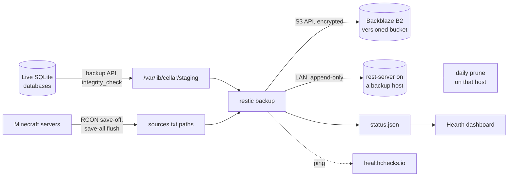

<h1 align="center">cellar</h1>

<p align="center">Encrypted backups for a home server, with restic: off-site to Backblaze B2, plus an append-only local copy.</p>

<p align="center">
  
  
  
</p>

cellar backs a single Linux server up to Backblaze B2 and, optionally, to a second machine on the LAN. restic takes
encrypted, deduplicated snapshots and sends them through B2's S3-compatible API and to an append-only
`rest-server` that the server itself can't delete from. Live SQLite databases are copied consistently, Minecraft
servers pause auto-save for the duration, every week each repository is checked, and every month a restore drill
proves the backups can be read.

The repo is generic. Machine-specific settings (paths, bucket, keys, passwords) live in `/etc/cellar/` and never
enter the repo; each config file has an example in `etc/`.



## Components

- `bin/cellar`, a single Python script (standard library only) that wraps restic. Subcommands: `backup`, `check`,
  `drill`, `status`, `snapshots`, `sources`, `restore`, `init`, `restic` (credentials loaded) and
  `stopped`; `--local` or `--b2` picks one repository.
- `systemd/`, a oneshot service and timer per job, at low CPU and idle IO priority:

  | Timer | When | What |
  |---|---|---|
  | `cellar-frequent` | every 30 minutes | short-term restore points, kept for 24 hours |
  | `cellar-backup` | 04:30 nightly | the main backup, then retention and prune |
  | `cellar-check` | Sundays 05:30 | `restic check`: a different 1/52 of B2 each week, all of the local copy |
  | `cellar-drill` | 1st of the month, 06:00 | restores and verifies a few files from B2, everything from the local copy |

- `install.sh` installs the script and units, creates `/etc/cellar` from the examples, generates the repository
  passwords, runs `restic init` if needed, enables the timers and runs a self-test. It's safe to re-run.
- `backup-host/`, the units and installer for the machine that keeps the local copy: `restic-rest-server
  --append-only` limited to the client's address, and a daily prune. [docs/backup-host.md](docs/backup-host.md)
  covers design and setup.

## Requirements

- A Debian or Ubuntu server with systemd and Python 3. `install.sh` installs [restic](https://restic.net) with
  `apt-get` if it's missing; 0.18 is the tested version.
- A Backblaze B2 account. Any S3-compatible store that restic supports should work, but only B2 is tested.
- Optional: a second Debian or Ubuntu machine on the LAN for the local copy, a
  [healthchecks.io](https://healthchecks.io) check, and Minecraft servers with RCON for save pausing.

## Install

1. Create a private B2 bucket whose lifecycle rule deletes prior versions after a few days, and an application
   key for that bucket alone. Once B2's daily download cap (1 GB free) is hit, every read fails, the nightly
   backup's included: raise it, or restore from a local copy.
2. `sudo install -d -m 700 /etc/cellar && sudo nano /etc/cellar/b2.env` (see `etc/b2.env.example`), then
   `sudo chmod 600 /etc/cellar/b2.env`.
3. `sudo ./install.sh`. It creates the other config files from the examples; edit them and run it again.
4. Store `/etc/cellar/restic.pass`, the B2 key and the bucket name somewhere other than the server. Without the
   password the backups can't be read.
5. Optional: the local copy ([docs/backup-host.md](docs/backup-host.md)).

## Usage

```bash
sudo cellar status                 # last results per job and repository, repo size, size per source
sudo cellar snapshots
sudo cellar sources                # which sources.txt lines exist
sudo cellar backup --tag pre-change
sudo cellar restic ls latest /etc/caddy
sudo cellar --local restore latest --target /var/tmp/r --include /srv/minecraft/world   # from the local copy
journalctl -u cellar-backup -n 50
systemctl list-timers 'cellar-*'
```

`cellar status` prints a one-screen summary:

```
backup    ok          2026-10-26T11:36:29+00:00
frequent  ok          2026-10-26T18:16:29+00:00
check     ok          2026-10-25T11:37:41+00:00
drill     ok          2026-10-01T12:01:24+00:00
repo      82 snapshots, 5.33 GB
       615.2 MB  /var/lib/cellar/staging
      1751.9 MB  /srv/minecraft
local copy:
  backup    ok          2026-10-26T11:37:02+00:00
  frequent  ok          2026-10-26T18:16:41+00:00
  repo      97 snapshots, 5.41 GB
```

## How a backup runs

1. Each database in `sqlite.txt` is copied with SQLite's backup API into `/var/lib/cellar/staging/<same path>`, as
   the database's owner (so no root-owned `-wal`/`-shm` files appear next to it), and has to pass
   `PRAGMA integrity_check`. The staged copies are backed up in place of the live files.
2. Each running Minecraft server gets `save-off` and `save-all flush` over RCON, and `save-on` in a `finally`
   block that also runs when systemd stops the job, so a failed run can't leave auto-save off.
3. `restic backup --tag <tag>` to B2 and then to the local copy, using the host's latest snapshot as its parent so
   unchanged files aren't re-read. Each repository succeeds or fails on its own. On B2, frequent snapshots are
   forgotten after 24 hours, and every other run then applies
   `forget --group-by host,tags --keep-daily 7 --keep-weekly 5 --keep-monthly 12 --prune`, with the repack capped by
   `PRUNE_MAX_REPACK` so one prune can't use up B2's daily download cap. Grouping by tag, never by path list, keeps
   `manual` snapshots from pushing nightly ones out. The backup host applies the same policy to the local copy.
4. `/var/lib/cellar/status.json` is written: nightly and manual runs under `backup`, half-hourly runs under
   `frequent`, so a working frequent run can't hide a failed nightly; the local copy under `local`.
   healthchecks.io is pinged per job (see `etc/cellar.env.example`).

A frequent run that finds another job holding the lock skips itself. A failure after the snapshot is saved
(restic exit code 3 included) makes the run `partial`, not `failed`; a run killed before it can write its result
is marked `failed` by `ExecStopPost`.

## Configuration

Everything is in `/etc/cellar/`, readable by root only.

| File | What |
|---|---|
| `b2.env` | `AWS_ACCESS_KEY_ID`, `AWS_SECRET_ACCESS_KEY`, `RESTIC_REPOSITORY=s3:https://<endpoint>/<bucket>`. Written by hand. |
| `restic.pass` | Repository password, generated by `install.sh`. Keep a copy off the server. |
| `local.env`, `local.pass` | Optional local copy: rest-server URL and login (by hand), its own repository password (generated). |
| `cellar.env` | `MINECRAFT` (unit:rcon-command pairs to pause auto-save on), optional `PRE_BACKUP` command, optional healthchecks.io URLs, `PRUNE_MAX_REPACK`. |
| `sources.txt` | Paths to back up, globs allowed. |
| `excludes.txt` | restic exclude patterns. |
| `sqlite.txt` | Live SQLite databases to copy with the backup API before each run; `nightly <path>` skips half-hourly runs. |
| `drill.txt` | Files the monthly drill restores and checks. |

## status.json

`/var/lib/cellar/status.json` is world-readable and holds no secrets. [Hearth](https://github.com/anthonyradke/hearth)
reads it to show backup state and alert on a failed or stale run. The schema is in [docs/status.md](docs/status.md).

## Layout

| Path | Contents |
|---|---|
| `bin/cellar` | The script: every subcommand, staging, RCON and status reporting |
| `systemd/` | A oneshot service and timer per job |
| `backup-host/` | rest-server and prune units, and the installer, for the machine holding the local copy |
| `etc/` | An example of each config file |
| `install.sh` | Installer and self-test |
| `tests/` | Unit tests against a fake restic: `python3 -m unittest discover -s tests` |
| `RESTORE.md` | Restoring onto a rebuilt server |
| `docs/status.md` | The `status.json` schema |
| `docs/backup-host.md` | The local copy: design, setup, restore |

## Known limitations

- The local copy sits on the same LAN, so B2 is still the only off-site copy.
- Restores are manual (`cellar restore`, `RESTORE.md`).
- The unit tests run against a fake restic. The monthly drill is the end-to-end test: it restores real files and
  checks their hashes and database integrity.
- Valheim has no save hook, so its world is copied while the server runs; `RESTORE.md` covers falling back to the
  game's own automatic backups.

## License

MIT. See [LICENSE](LICENSE).
