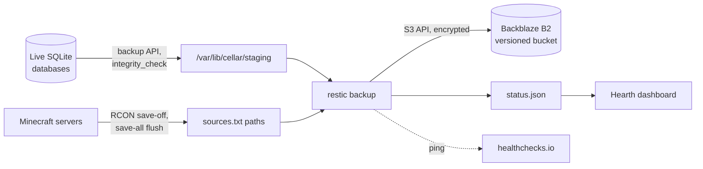

<h1 align="center">cellar</h1>

<p align="center">Encrypted off-box backups for a home server, with restic and Backblaze B2.</p>

<p align="center">
  
  
  
</p>

cellar backs a single Linux server up to Backblaze B2 without any other machine involved. restic takes encrypted,
deduplicated snapshots and sends them through B2's S3-compatible API. Live SQLite databases are copied consistently,
Minecraft servers pause auto-save for the duration, every week the repository is checked, and every month a restore
drill proves the backups can actually be read.

The repo is generic. Machine-specific settings (paths, bucket, keys, the repository password) live in `/etc/cellar/`
on the server and never enter the repo; each config file has an example in `etc/`.



## What's in it

- `bin/cellar`, a single Python script (standard library only) that wraps restic. Subcommands: `backup`, `check`,
  `drill`, `status`, `snapshots`, `sources`, `restore`, `init`, and `restic` (runs restic with the credentials loaded).
- `systemd/`, a oneshot service and timer per job, all at low CPU and idle IO priority so the game servers on the
  same machine aren't affected:

  | Timer | When | What |
  |---|---|---|
  | `cellar-frequent` | every 30 minutes | short-term restore points, kept for 24 hours |
  | `cellar-backup` | 04:30 nightly | the main backup, then retention and prune |
  | `cellar-check` | Sundays 05:30 | `restic check` on a 10% data subset |
  | `cellar-drill` | 1st of the month, 06:00 | restores a few files and verifies them |

- `install.sh` installs the script and units, creates `/etc/cellar` from the examples, generates the repository
  password, runs `restic init` if needed, enables the timers and runs a self-test. It's safe to re-run.
- `RESTORE.md`, the step-by-step for bringing everything back onto a rebuilt server.

## How a backup runs

1. Each database in `sqlite.txt` is copied with SQLite's backup API into `/var/lib/cellar/staging/<same path>`. The
   copy runs as the database's owner, so SQLite never leaves root-owned `-wal`/`-shm` files next to the live
   database, and each copy has to pass `PRAGMA integrity_check`. The live files are excluded and the staged copies
   are backed up in their place.
2. Each running Minecraft server gets `save-off` and `save-all flush` over RCON, and `save-on` afterwards. That
   happens in a `finally` block that also runs when systemd stops the job, so a failed run can't leave auto-save off.
3. `restic backup --tag <tag>`. Frequent snapshots are forgotten after 24 hours. Every other run then applies
   `forget --group-by host,tags --keep-daily 7 --keep-weekly 5 --keep-monthly 12 --prune`. Grouping by tag keeps
   `manual` and `pre-change` snapshots on their own retention so they never push nightly ones out.
4. `/var/lib/cellar/status.json` is written and healthchecks.io is pinged if `HC_URL` is set.

restic exit code 3 means some files couldn't be read but a snapshot was still saved. That's recorded as `partial`
rather than `failed`.

## Config (`/etc/cellar/`, root only)

| File | What |
|---|---|
| `b2.env` | `AWS_ACCESS_KEY_ID`, `AWS_SECRET_ACCESS_KEY`, `RESTIC_REPOSITORY=s3:https://<endpoint>/<bucket>`. Written by hand. |
| `restic.pass` | Repository password, generated by `install.sh`. Keep a copy off the server. |
| `cellar.env` | `MINECRAFT` (unit:rcon-command pairs to pause auto-save on) and an optional `HC_URL` for healthchecks.io. |
| `sources.txt` | Paths to back up, globs allowed. |
| `excludes.txt` | restic exclude patterns. |
| `sqlite.txt` | Live SQLite databases to copy with the backup API before each run. |
| `drill.txt` | Files the monthly drill restores and checks. |

## Everyday commands

```bash
sudo cellar status                 # last backup, check, drill, repo size, size per source
sudo cellar snapshots
sudo cellar sources                # which sources.txt lines exist
sudo cellar backup --tag pre-change
sudo cellar restic ls latest /etc/caddy
sudo cellar restore latest --target /tmp/r --include /srv/minecraft/world
journalctl -u cellar-backup -n 50
systemctl list-timers 'cellar-*'
```

`cellar status` prints a one-screen summary:

```
backup  ok       2026-10-26T18:16:29+00:00
check   ok       2026-10-25T11:37:41+00:00
drill   ok       2026-10-01T12:01:24+00:00
repo    338 snapshots, 9.33 GB
       137.4 MB  /etc
       615.2 MB  /var/lib/cellar/staging
      1751.9 MB  /srv/minecraft
       238.9 MB  /srv/valheim
```

## status.json

`/var/lib/cellar/status.json` is world-readable and holds no secrets; [Hearth](https://github.com/anthonyradke/hearth)
reads it. The top level is `schema` (currently `1`), `updated`, and these sections, each present once that job has
run at least once:

```jsonc
{
  "schema": 1,
  "updated": "2026-09-24T10:41:02+00:00",      // UTC, ISO 8601, every timestamp
  "last_success": "…",                          // last backup that ended ok or partial
  "backup": {
    "started": "…", "finished": "…",            // finished is null while running
    "result": "running | ok | partial | failed",
    "error": null,                              // text when partial or failed
    "tag": "nightly",
    "snapshot": "3f9c…",                        // full snapshot id
    "bytes_added": 0, "bytes_uploaded": 0,      // new data, before and after compression
    "bytes_total": 0,                           // everything the backup read
    "files_new": 0, "files_changed": 0, "files_total": 0,
    "missing_sources": []                       // sources.txt lines that matched nothing
  },
  "repo":    { "snapshots": 0, "size_bytes": 0, "measured": "…" },   // size_bytes = stored size in the bucket
  "sources": [ { "path": "/etc", "bytes": 0 } ],                      // per source, from the latest snapshot
  "check":   { "started": "…", "finished": "…", "result": "running | ok | failed", "error": null, "subset": "10%" },
  "drill":   { "started": "…", "finished": "…", "result": "running | ok | failed", "error": null,
               "snapshot": "3f9c1a2b",
               "files": [ { "path": "…", "bytes": 0, "sha256": "…", "integrity": "ok" } ] }  // integrity only for .db/.sqlite
}
```

Adding fields is fine. Renaming or removing one means bumping `schema` and updating Hearth.

## Setup

1. Create a private B2 bucket with a lifecycle rule that keeps prior versions for 30 days, so a compromised server
   can't destroy the backups immediately. Create an application key restricted to that bucket, with read and write.
   Under Caps & Alerts, raise the daily download cap above the free 1 GB: when a cap is hit B2 refuses every read,
   including the ones a nightly backup needs, and a full restore is larger than 1 GB.
2. `sudo install -d -m 700 /etc/cellar && sudo nano /etc/cellar/b2.env` (see `etc/b2.env.example`), then
   `sudo chmod 600 /etc/cellar/b2.env`.
3. `sudo ./install.sh`. It creates the remaining config files from the examples, which then need editing for the
   machine. Run it again after editing.
4. Store `/etc/cellar/restic.pass`, the B2 key and the bucket name somewhere other than the server. Without the
   password the backups can't be read.

## Known limitations

- One server, one repository. There's no second destination, so B2 is the only off-site copy.
- Restores are manual (`cellar restore` and `RESTORE.md`); nothing rebuilds a machine automatically.
- There's no unit test suite. The monthly drill is the end-to-end test: it restores real files from the latest
  snapshot and checks their hashes and, for databases, their integrity.
- Valheim has no save hook, so its world files are copied while the server runs; `RESTORE.md` explains how to fall back
  to the game's own automatic backups if a live copy is inconsistent.

## License

MIT. See [LICENSE](LICENSE).
